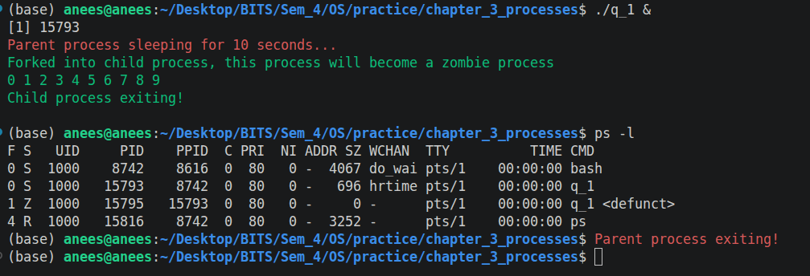
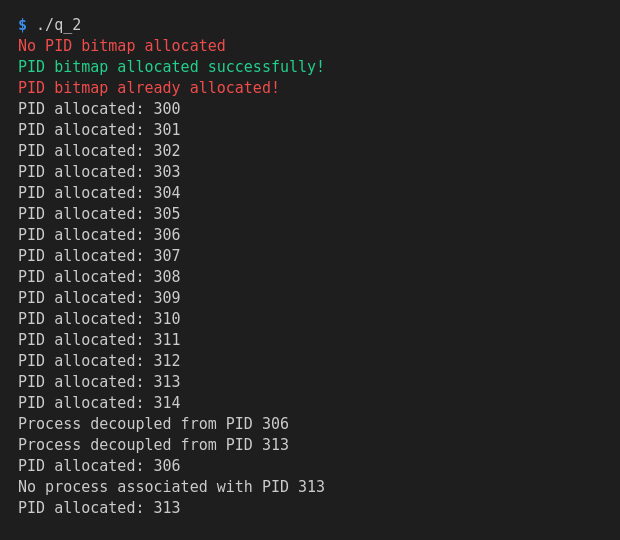

# Chapter 3: Processes

Solutions to the programming exercises of the Processes chapter, with what each one taught.

## Programs

| File | Topic | What it shows |
| --- | --- | --- |
| [q_1.c](q_1.c) | Zombie processes | A child that has exited stays in the process table until its parent calls `wait()`. |
| [q_2.c](q_2.c) | Pid manager, bitmaps | Tracking which PIDs are in use with one bit per PID. |

## q_1: creating a zombie process

**Task:** fork a child that becomes a zombie and stays one for at least 10 seconds, then confirm it with `ps -l`.

**How it works:** the child prints a few numbers and exits straight away. The parent sleeps for 10 seconds and never calls `wait()`, so for those 10 seconds nobody collects the child's exit status.

### Running it

```sh
make            # from the repository root, or: gcc -Wall -Wextra -o q_1 q_1.c
./q_1 &         # background, so the shell gives the prompt back
ps -l           # within 10 seconds, in the same terminal
```

### Output



Reading the `ps -l` table:

| PID | PPID | S | CMD | What it is |
| --- | --- | --- | --- | --- |
| 15793 | 8742 | `S` | `q_1` | The parent, asleep in `sleep(10)`. Its parent is the shell. |
| 15795 | 15793 | `Z` | `q_1 <defunct>` | The child. It has exited and is a zombie; its PPID is the parent's PID. |

### Learnings

- **What a zombie is.** When a process terminates, its memory is released but its entry in the process table stays, because that entry holds the exit status the parent is expected to read. Between the child's exit and the parent's `wait()`, the child is a zombie.
- **How to make one.** Let the child finish first and keep the parent alive without calling `wait()`.
- **How to recognise one.** In `ps -l` the `S` column shows `Z` and the command is marked `<defunct>`. `SZ` is 0, since the process no longer holds any memory.
- **`ps -l` is per terminal.** It lists only the processes attached to the terminal it is run in. From a different terminal the zombie does not show up; use `ps -el` there to list every process on the system.
- **Run it with `&`.** In the foreground the shell only returns the prompt after the parent has exited, and by then the zombie is gone.
- **A zombie cannot be killed.** It is already dead, so signals sent to it do nothing. It disappears in one of two ways:
  - the parent calls `wait()`, or
  - the parent terminates. The zombie is then adopted by `init` (`systemd`), which calls `wait()` for it.
- **Cleaning up.** `kill <parent pid>` removes the zombie for the second reason. In this program the parent also exits on its own after 10 seconds.
- **Why zombies matter.** Each one occupies a process table entry and a PID. A long-running parent that never waits for its children can eventually use up the table.

## q_2: a pid manager

**Task:** implement the part of the operating system that hands out process identifiers in the range 300 to 5000 and takes them back:

| Function | Does | Returns |
| --- | --- | --- |
| `int allocate_map(void)` | Creates the data structure that tracks the PIDs | 1 if successful, -1 if not |
| `int allocate_pid(void)` | Allocates a PID | the PID, or -1 if all are in use |
| `void release_pid(int pid)` | Releases a PID | nothing |

No processes are created. The program plays the role of the code that sits behind `fork()`, not of a program that calls it.

**How it works:** a bitmap in which every PID owns one bit, 0 for free and 1 for in use. The bits are packed 32 to a `uint32_t`:

```
pid_bank[0]    -> PIDs  300 ..  331
pid_bank[1]    -> PIDs  332 ..  363
...
pid_bank[146]  -> PIDs 4972 .. 5000   (3 bits left over)
```

`allocate_pid()` scans for the first 0 bit, sets it and returns the PID it stands for, so the lowest free PID is always handed out first. `release_pid()` clears the bit.

### Running it

```sh
make            # from the repository root, or: gcc -Wall -Wextra -o q_2 q_2.c
./q_2
```

### Output



| Lines | What they show |
| --- | --- |
| `No PID bitmap allocated` | `allocate_pid()` returns -1 when called before `allocate_map()`. |
| `PID bitmap already allocated!` | A second `allocate_map()` is refused instead of replacing the bitmap. |
| `300` to `314` | PIDs are handed out in increasing order from `MIN_PID`. |
| Release 306 and 313, then `306` | Released PIDs are reused, lowest first. |
| `No process associated with PID 313`, then `313` | Releasing a PID that is already free changes nothing. |

The other end of the range was checked during development with a loop of 4701 + 15 calls: the last PID handed out is 5000, and every call after it returns -1.

### Learnings

**Bitmaps**

- **Size.** 5000 - 300 + 1 = 4701 PIDs need 4701 bits, which is 147 `uint32_t` or 588 bytes. An `int` array with one element per PID would take 4701 × 4 = 18,804 bytes.
- **Rounding up.** `(n + 32 - 1) / 32` is integer division that rounds up. It gives the number of 32-bit elements needed for `n` bits.
- **Finding a bit.** For a PID: `i = pid - MIN_PID`, then `idx = i / 32` is the array element and `pos = i % 32` is the bit inside it. PID 370 is bit index 70, which is `pid_bank[2]`, bit 6.
- **The three operations**, with `mask = 1U << pos`:

  | Operation | Code |
  | --- | --- |
  | Set the bit | `word \|= mask` |
  | Clear the bit | `word &= ~mask` |
  | Test the bit | `word & mask` |

- **Clearing with `& ~`, not `^`.** `^` flips the bit, so releasing a PID that is already free would mark it as in use. `& ~mask` gives 0 either way.

**C details that caused bugs**

- **`&=` is not `&`.** Testing a bit with `word &= mask` writes the result back and wipes the other 31 bits of the word. The symptom was the output 300, 301, 300, 301: every check erased the PIDs allocated before it.
- **Unsigned for bit work.** In a signed `int`, bit 31 is the sign bit. The elements are `uint32_t` (from `<stdint.h>`) and the literal is `1U`, because `1 << pos` is evaluated as a signed `int` regardless of the type it is stored into.
- **Spare bits.** 147 × 32 = 4704 bits exist but only 4701 are PIDs. Looping over every bit in memory handed out 5001, 5002 and 5003. The PID has to be checked against `MAX_PID` before its bit is set.
- **Only 0 is false.** `if (allocate_map())` is true for -1 as well, so the failure branch could never run. The return value has to be compared explicitly: `allocate_map() > 0`.
- **Macros are pasted as text.** Without outer parentheses, `100 / BOXES` expands to `100 / (4732) / 32`. Any macro containing an operator gets wrapped in parentheses.
- **Named constants everywhere.** A `300` or `5000` written directly in a function goes wrong the day `MIN_PID` or `MAX_PID` is changed.

**Memory**

- **`calloc()` zeroes the memory**, so every PID starts free. `malloc()` gives no such guarantee.
- **`free()` what was allocated.** Before the `free` was added, valgrind reported `in use at exit: 588 bytes in 1 blocks`, exactly the bitmap.
- **Set the pointer to `NULL` after `free()`.** Otherwise it is a dangling pointer, and using it is a use-after-free. With `NULL`, the guards at the top of each function catch the mistake.
- **Guard against wrong call order.** Each function checks `pid_bank` first: allocating or releasing without a bitmap is refused, and so is creating a second bitmap, which would leak the first and forget every PID in use.

**Testing**

- **`allocate_pid()` takes no argument**, so the test does not choose PIDs. With a "lowest free PID first" strategy every result can be predicted exactly, which makes a wrong one obvious.
- **Go past the limit.** A loop of exactly 4701 calls ended at 5000 and looked correct. Both bugs at the end of the range only appeared when the loop asked for more PIDs than exist.
- **Check return values in the test.** A test that relies on a message printed inside the function stops testing anything when that message is removed.
- **Do not check what cannot fail.** Testing a bit right after clearing it adds a branch that can never be taken.
